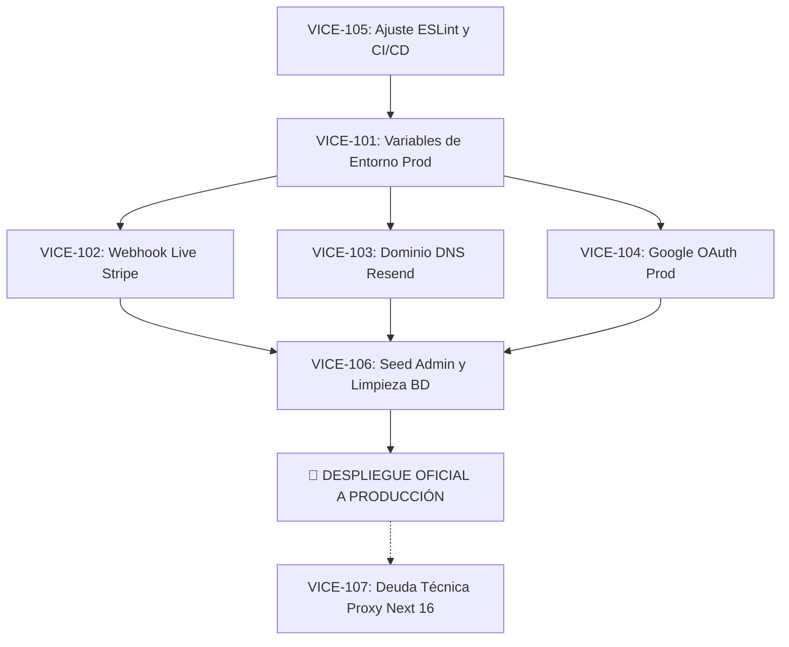

# Auditoría Técnica de `develop` y Matriz de Tareas JIRA para Producción

**Proyecto:** Vice City — Sistema Web Deportivo  
**Fecha de Auditoría:** 13 de Octubre de 2026  
**Rama Auditada:** `develop` (Commit: `b4585bb`)  
**Dictamen General:** **LISTO CON RESTRICCIONES (Aprobado para pruebas locales integradas / Requiere configuración de infraestructura para producción)**  

---

## 1. Resumen Ejecutivo de la Auditoría

Se realizó una inspección exhaustiva de la rama `develop` tras la consolidación de las ramas `backend` y `develop` (PR #50 y PR #51). El sistema es completamente funcional en entorno local, cumple con las reglas de negocio del SRS y compila limpiamente para producción.

### Indicadores Clave de Calidad
- **Pruebas Automatizadas (`npm test`):** **359 / 359 APROBADAS (100%)** en 53 suites de prueba (Duración: 23.89s).
- **Tipado TypeScript (`npx tsc --noEmit`):** **0 Errores** de compilación.
- **Compilación de Producción (`next build` con Turbopack):** **EXITOSA** (47 páginas estáticas y dinámicas generadas).
- **Base de Datos & ORM (`npx prisma validate` + `npm run diagnose`):** **CONECTADO Y VÁLIDO** (Conexión activa a PostgreSQL / Supabase).
- **Análisis de Linter (`npm run lint`):** **REQUERIDO AJUSTE** (218 observaciones por análisis accidental de `api-tester/dist/` y regla estricta `no-explicit-any`).

---

## 2. Resultados de las Pruebas y Validación por Módulo

| Módulo | Pruebas Unitarias/Integración | Estado Funcional | Observaciones de Auditoría |
| :--- | :---: | :---: | :--- |
| **Autenticación & Sesiones** | 68 pruebas | **APROBADO** | Login con bcrypt, cookies de sesión NextAuth compatibles con middleware, registro con rol `CLIENT`, confirmación y reseteo por token seguro, y flujo de Google OAuth. |
| **Reservas & Disponibilidad** | 52 pruebas | **APROBADO** | Ventana HOLD de 10 min (RN-011), restricción de exclusión en PostgreSQL (`bookings_no_overlap`), manejo de zona horaria `America/Bogota` y festivos colombianos. |
| **Pagos (Stripe Gateway)** | 35 pruebas | **APROBADO** | Migrado a *Dynamic Payment Methods* (`automatic_payment_methods: { enabled: true }`). Webhook procesa cuerpo crudo y valida firma criptográfica `stripe-signature` (RN-016 y RN-018 sin reembolsos en MVP). |
| **Control de Acceso QR & Tickets**| 48 pruebas | **APROBADO** | Generación de tickets criptográficos de 128 bits, registro en `access_logs`, prevención de reuso y validación de horarios (RN-019). |
| **POS & Venta en Taquilla** | 30 pruebas | **APROBADO** | Venta presencial para empleados con roles `TICKET_SELLER` y `ADMIN` (RN-010). |
| **Roles & Permisos (RBAC)** | 42 pruebas | **APROBADO** | Protección de rutas en middleware según matriz SRS (`ADMIN`, `CLIENT`, `TICKET_SELLER`, `QR_VALIDATOR`). No permite degradar al único administrador. |
| **Métricas & Catálogo** | 84 pruebas | **APROBADO** | Agrupación de métricas de ingresos, cálculo de precios dinámicos (descuento miércoles 20%) y contratos OpenAPI 3.0.3. |

---

## 3. Matriz de Tareas JIRA a Delegar antes de Producción

Las siguientes tareas representan los bloqueantes y pre-requisitos técnicos que el equipo debe completar en JIRA antes del despliegue productivo:

```
[EPIC]: PRE-PRODUCCIÓN E INFRAESTRUCTURA (FT-PROD)
```

---

### 📌 [VICE-101] Configuración de Variables de Entorno y Secretos de Producción
* **Tipo:** Tarea (*Task*)  
* **Prioridad:** **Bloqueante (*Highest*)**  
* **Componente:** DevOps / Infraestructura  
* **Estimación:** 3 Story Points  
* **Responsable sugerido:** DevOps Engineer / Tech Lead  

#### Descripción:
Actualmente el proyecto utiliza variables orientadas al entorno local y llaves de prueba de Stripe en `.env`. Para el despliegue en Vercel/Railway/AWS, se debe configurar el juego completo de variables de entorno de producción sin exponer credenciales en repositorios ni logs.

#### Criterios de Aceptación:
1. `NEXTAUTH_URL` y `NEXT_PUBLIC_APP_URL` deben apuntar al dominio público oficial con protocolo `https://`.
2. `NEXTAUTH_SECRET` debe ser una cadena aleatoria de al menos 64 caracteres de alta entropía.
3. Las variables de conexión a base de datos (`DATABASE_URL` y `DIRECT_URL`) deben apuntar a la instancia de producción de Supabase/PostgreSQL.
4. Las llaves de Stripe deben cambiarse de `pk_test_...` / `sk_test_...` a `pk_live_...` / `sk_live_...`.
5. Ningún secreto debe estar presente en código fuente ni subido a Git.

#### Definición de Terminado (DoD):
- Variables inyectadas en la plataforma de hosting.
- Ejecución de `npm run diagnose` en el entorno de staging/producción validada exitosamente.

---

### 📌 [VICE-102] Registro y Configuración del Webhook de Stripe en Modo Live
* **Tipo:** Tarea (*Task*)  
* **Prioridad:** **Bloqueante (*Highest*)**  
* **Componente:** Backend / Pasarela de Pagos  
* **Estimación:** 2 Story Points  
* **Responsable sugerido:** Backend Developer  

#### Descripción:
En local se utilizó Stripe CLI (`stripe listen`). En producción, Stripe debe enviar directamente las notificaciones HTTP POST de cobros exitosos al endpoint público de Vice City para confirmar reservas y emitir tickets (RN-016).

#### Criterios de Aceptación:
1. Crear el endpoint en Stripe Dashboard (Modo Live): `https://tudominio.com/api/payments/webhook`.
2. Suscribir exclusivamente los eventos requeridos: `payment_intent.succeeded` (y opcionalmente `payment_intent.payment_failed`).
3. Revelar el secreto de firma generado (`whsec_...`) e inyectarlo en la variable de entorno `STRIPE_WEBHOOK_SECRET` de producción.
4. Probar un webhook controlado en Stripe Dashboard y certificar respuesta HTTP `200 OK`.

#### Definición de Terminado (DoD):
- Envío de webhook de prueba exitoso registrado en los logs de Stripe sin fallas de firma criptográfica (`InvalidWebhookSignatureError`).

---

### 📌 [VICE-103] Verificación de Dominio Corporativo en Proveedor de Correo (Resend)
* **Tipo:** Tarea (*Task*)  
* **Prioridad:** **Alta (*High*)**  
* **Componente:** Infraestructura / Correos  
* **Estimación:** 3 Story Points  
* **Responsable sugerido:** DevOps / Administrador de Dominio  

#### Descripción:
El proyecto utiliza actualmente la cuenta de pruebas de Resend con el remitente `onboarding@resend.dev`. Este remitente solo permite enviar correos a la dirección del propietario de la cuenta. En producción es obligatorio registrar y verificar el dominio oficial para enviar confirmaciones de reserva y tickets con QR a los clientes finales.

#### Criterios de Aceptación:
1. Registrar el dominio del complejo deportivo en el panel de [Resend](https://resend.com/domains).
2. Configurar los registros DNS correspondientes en el proveedor del dominio:
   - Registro SPF (`TXT`)
   - Registros DKIM (`CNAME`)
   - Registro DMARC (`TXT`)
3. Verificar que el estado del dominio en Resend sea **Verified**.
4. Actualizar la variable de entorno `EMAIL_FROM="Vice City <reservas@tudominio.com>"`.

#### Definición de Terminado (DoD):
- Envío exitoso de un correo de confirmación de reserva con ticket QR a una cuenta externa (Gmail/Outlook).

---

### 📌 [VICE-104] Configuración de URIs de Redirección OAuth en Google Cloud Console
* **Tipo:** Tarea (*Task*)  
* **Prioridad:** **Media (*Medium*)**  
* **Componente:** Backend / Autenticación  
* **Estimación:** 2 Story Points  
* **Responsable sugerido:** Backend Developer  

#### Descripción:
Google OAuth rechaza peticiones si la URL del cliente no está registrada en la lista blanca de la consola de Google Cloud. Debe autorizarse el dominio de producción para permitir el login con Google.

#### Criterios de Aceptación:
1. En Google Cloud Console > APIs & Services > Credentials > OAuth 2.0 Client IDs:
   - Agregar a **Orígenes de JavaScript autorizados**: `https://tudominio.com`.
   - Agregar a **URIs de redirección autorizados**: `https://tudominio.com/api/auth/callback/google`.
2. Comprobar que el flujo de login con Google redirija correctamente y cree la sesión de cliente sin error `redirect_uri_mismatch`.

#### Definición de Terminado (DoD):
- Login y vinculación con Google funcionando en el dominio productivo.

---

### 📌 [VICE-105] Optimización de Configuración ESLint y Pipeline CI/CD
* **Tipo:** Deuda Técnica / Bug  
* **Prioridad:** **Media (*Medium*)**  
* **Componente:** Calidad de Código / CI-CD  
* **Estimación:** 2 Story Points  
* **Responsable sugerido:** Frontend / Backend Developer  

#### Descripción:
La auditoría identificó que `npm run lint` falla con 218 observaciones. La causa principal es que `eslint.config.mjs` no excluye la carpeta de artefactos compilados `api-tester/dist/` (provocando que Babel analice bundles minificados de 500KB) y la regla `@typescript-eslint/no-explicit-any` está configurada como error estricto. Esto bloquearía cualquier pipeline de integración continua que ejecute `npm run lint`.

#### Criterios de Aceptación:
1. Agregar `"api-tester/**"` a `globalIgnores` en `eslint.config.mjs`.
2. Configurar la severidad de `@typescript-eslint/no-explicit-any` como `"warn"` en `eslint.config.mjs` mientras se tipan los mocks restantes.
3. El comando `npm run lint` debe ejecutarse en menos de 10 segundos y finalizar con código de salida `0` (verde).

#### Definición de Terminado (DoD):
- Pipeline de GitHub Actions ejecutando `npm run lint`, `npx tsc --noEmit` y `npm test` exitosamente en verde.

---

### 📌 [VICE-106] Limpieza de Datos de Testing y Siembra de Superusuario Administrador
* **Tipo:** Tarea (*Task*)  
* **Prioridad:** **Alta (*High*)**  
* **Componente:** Base de Datos / Seguridad  
* **Estimación:** 2 Story Points  
* **Responsable sugerido:** DBA / Backend Developer  

#### Descripción:
En la base de datos de desarrollo existen usuarios y reservas generadas durante las pruebas manuales. Para producción, se debe asegurar que la base esté limpia de registros ficticios y que el primer usuario `ADMIN` sea inicializado mediante script seguro.

#### Criterios de Aceptación:
1. Asegurar que la base de datos de producción tenga aplicadas las migraciones de Prisma sin datos residuales de tests.
2. Definir la variable de entorno `ADMIN_SEED_PASSWORD` con una contraseña robusta.
3. Ejecutar `npm run db:seed:admin`.
4. Verificar inicio de sesión exitoso del administrador y acceso restringido al panel `/admin`.

#### Definición de Terminado (DoD):
- Usuario administrador activo con contraseña cifrada (bcrypt) y permisos habilitados.

---

### 📌 [VICE-107] Preparación de Migración de Middleware a Proxy (Next.js 16)
* **Tipo:** Deuda Técnica (*Tech Debt*)  
* **Prioridad:** **Baja (*Low*)**  
* **Componente:** Arquitectura Next.js  
* **Estimación:** 2 Story Points  
* **Responsable sugerido:** Fullstack Developer  

#### Descripción:
Durante la compilación, Next.js 16.3 emite la advertencia: *"The 'middleware' file convention is deprecated. Please use 'proxy' instead"*. Aunque la aplicación compila y opera perfectamente hoy, se debe programar la migración preventiva para futuras versiones mayores de Next.js.

#### Criterios de Aceptación:
1. Evaluar el codemod oficial: `npx @next/codemod@canary middleware-to-proxy .`.
2. Verificar que las reglas de protección de rutas por roles sigan vigentes.

#### Definición de Terminado (DoD):
- Desaparición del deprecation warning en la salida de `npm run build`.

---

## 4. Orden de Ejecución Sugerido (Sprint Backlog)



---

## 5. Conclusión y Checklist de Autorización para Producción

| Ítem de Verificación | Estado Actual | ¿Aprobado para Producción? |
| :--- | :---: | :---: |
| **Lógica de negocio y contratos de API** | 100% probado (359 tests) | ✅ SÍ |
| **Compilación de producción (`next build`)** | Optimizada con Turbopack | ✅ SÍ |
| **Control de solapamiento y reservas (HOLD)** | Reglas PostgreSQL activas | ✅ SÍ |
| **Linter de CI/CD** | Requiere excluir `api-tester` | ⚠️ PENDIENTE (VICE-105) |
| **Pasarela Stripe en Modo Real** | Llaves de prueba activas | ❌ NO (Requiere VICE-101 y VICE-102) |
| **Dominio y Correo Transaccional** | Remitente de prueba | ❌ NO (Requiere VICE-103) |
| **Credenciales del Administrador** | Password por defecto | ❌ NO (Requiere VICE-106) |

