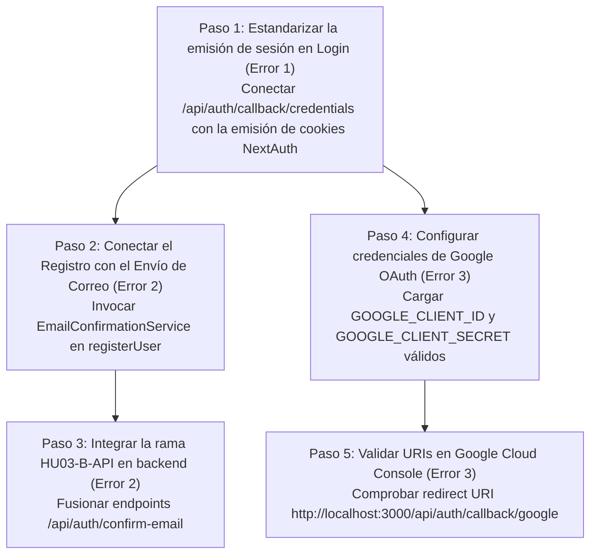

# Informe Técnico de Diagnóstico de Autenticación desde el Backend — Vice City

> **Actualización (VCP-84):** este informe es histórico. El endpoint `POST /api/auth/google` que se describe aquí **fue retirado** y responde `410 ENDPOINT_RETIRED`, porque aceptaba el perfil enviado por el cliente sin verificar ningún token de Google. El inicio de sesión con Google se hace únicamente por NextAuth (`/api/auth/signin/google`), que ahora exige `email_verified === true`. Las referencias a ese endpoint más abajo describen el estado anterior.

Este informe presenta el diagnóstico técnico y exhaustivo de los tres errores de autenticación reportados, realizado **exclusivamente sobre la arquitectura, código fuente, servicios y configuración del backend** en la rama `backend`.

---

## A. Resumen Ejecutivo

| Flujo Reportado | Estado en Backend | Causa Principal Identificada | Nivel de Certeza | Capa Responsable |
| :--- | :---: | :--- | :---: | :--- |
| **1. Login con correo y contraseña** | **Divergencia Arquitectónica de Sesión** | `POST /api/auth/login` valida credenciales y devuelve JSON exitoso, pero **no emite la cookie de sesión JWT** (`next-auth.session-token`). El middleware perimetral la exige, rechazando las solicitudes posteriores con `401 Unauthorized`. | **Causa Confirmada** | Capa API / Gestión de Sesiones |
| **2. Confirmación de correo** | **Flujo Desconectado y Ramas No Integradas** | `registerUser` y `POST /api/auth/register` **nunca invocan** `EmailConfirmationService`. Además, los endpoints de confirmación (`/api/auth/confirm-email`) están en una rama de feature sin integrar, y el emisor configurado es `ConsoleEmailSender` (no existe proveedor SMTP o API externa). | **Causa Confirmada** | Lógica de Negocio / Capa API |
| **3. Google OAuth** | **Falta de Credenciales y Desacople de Sesión** | `GoogleProvider` recurre a placeholders por variables ausentes (`GOOGLE_CLIENT_ID`). Adicionalmente, el endpoint alternativo `POST /api/auth/google` no genera cookies de sesión de NextAuth. | **Causa Confirmada** (Código) / **Hipótesis Probable** (Google Cloud) | Configuración de Entorno / Integración OAuth |

---

## B. Diagnóstico del Login (Error 1)

### 1. Causa Confirmada e Hipótesis Principal
**Divergencia entre el Route Handler REST y el Perímetro de Sesiones NextAuth:**
* El endpoint `POST /api/auth/login` (`src/app/api/auth/login/route.ts`) valida correctamente las credenciales contra PostgreSQL mediante bcrypt y retorna un objeto JSON `{ success: true, data: { id, email, name, role } }` con código HTTP `200 OK`.
* **Sin embargo, este endpoint nunca emite un encabezado `Set-Cookie` con la cookie de sesión JWT** (`next-auth.session-token`).
* Todo el perímetro de autorización del backend (`src/middleware.ts` y `src/features/auth/permissions/route-permissions.ts`) utiliza la función `getToken({ req, secret })` de NextAuth para inspeccionar dicha cookie.
* **Efecto observado:** Un cliente que realiza una solicitud a `/api/auth/login` obtiene una respuesta exitosa, pero su navegador o cliente HTTP no recibe ninguna cookie de sesión; al intentar acceder de inmediato a cualquier ruta o endpoint protegido (`/admin`, `/client`, etc.), el middleware responde de inmediato **`401 Unauthorized`**.

### 2. Evidencia Encontrada en el Código

1. **El Route Handler retorna JSON plano sin cookies:**
   En `src/app/api/auth/login/route.ts`:
   ```typescript
   const user = await authenticateUser(validationResult.data);
   return NextResponse.json(
     {
       success: true,
       message: "Inicio de sesión exitoso",
       data: { id: user.id, email: user.email, name: user.name, role: user.role },
     },
     { status: 200 }
   );
   ```
2. **El Middleware exige la cookie de NextAuth:**
   En `src/middleware.ts`:
   ```typescript
   token = await getToken({ req: request, secret: getMiddlewareSecret() });
   if (!token) {
     if (isApiRoute) {
       return NextResponse.json({ success: false, error: "UNAUTHORIZED", ... }, { status: 401 });
     }
     return NextResponse.redirect(loginUrl);
   }
   ```
3. **El mecanismo de emisión de cookies de NextAuth reside en su handler interno:**
   En `src/lib/auth.ts`, existe `CredentialsProvider` configurado con su callback `authorize()`, pero este solo se ejecuta cuando la petición se envía al endpoint nativo de NextAuth: `POST /api/auth/callback/credentials`.
4. **Comprobación de la política de verificación de correo:**
   Se verificó si existía un bloqueo por correo no verificado en `src/lib/auth.ts`. La búsqueda de usuario filtra únicamente por `is_active: true` y no condiciona el login a `email_verified: true`. La falta de verificación de correo **no** es la causa del fallo de login.

### 3. Archivos y Funciones Implicadas
* `src/app/api/auth/login/route.ts`: Función `POST`.
* `src/lib/auth.ts`: Funciones `authenticateUser`, `authOptions` y `CredentialsProvider`.
* `src/middleware.ts`: Función `middleware`.

### 4. Capa Responsable
**Capa API y Gestión de Sesiones.**

### 5. Solución Recomendada
Estandarizar el contrato de inicio de sesión del sistema:
* **Opción A (Recomendada y nativa en NextAuth):** Hacer que el inicio de sesión por credenciales se procese mediante `POST /api/auth/callback/credentials` (la llamada estándar de NextAuth que invoca el `CredentialsProvider` ya configurado en `authOptions`), garantizando que NextAuth cree el JWT y configure la cabecera `Set-Cookie`.
* **Opción B:** Si se requiere mantener el endpoint personalizado `POST /api/auth/login`, este Route Handler debe construir manualmente el token JWT cifrado con `encode({ token, secret })` de NextAuth y emitir la cookie `next-auth.session-token` en la respuesta de `NextResponse`.

### 6. Prueba para Confirmar la Solución
Ejecutar una prueba de integración HTTP que envíe credenciales válidas y confirme:
1. Código de estado `200 OK`.
2. Presencia del encabezado `Set-Cookie` con `next-auth.session-token`.
3. Que una petición subsecuente a `/api/admin/users` o `/api/auth/session` adjuntando esa cookie responda con status exitoso sin redirección ni `401 Unauthorized`.

### 7. Nivel de Certeza
**Causa confirmada.**

---

## C. Diagnóstico del Correo de Confirmación (Error 2)

### 1. Causa Confirmada e Hipótesis Principal
**Desconexión total entre el registro y el servicio de confirmación, y falta de endpoints e infraestructura real de correo:**
1. **El registro no invoca el servicio de correo:** En `src/app/api/auth/register/route.ts` y `src/features/auth/services/register.service.ts`, la lógica persiste el usuario en la tabla `users` mediante Prisma y finaliza inmediatamente. **Nunca se instancia ni se llama a `EmailConfirmationService.sendVerificationEmail()`**.
2. **Los endpoints de confirmación no están integrados en `backend`:** Las rutas `POST /api/auth/confirm-email` y `POST /api/auth/resend-confirmation` existen únicamente en la rama `feature/HU03-B-API/confirmacion-correo/jandy-pena`, la cual **nunca fue fusionada en la rama `backend`**.
3. **No existe un proveedor de correo externo:** La implementación de `src/features/auth/services/email.service.ts` utiliza `ConsoleEmailSender`, cuya función es simplemente imprimir el enlace de confirmación en la consola del servidor (`console.log`). No hay integración con proveedores SMTP, Resend o SendGrid.

### 2. Evidencia Encontrada en el Código

1. **Inspección de `registerUser`:**
   En `src/features/auth/services/register.service.ts`:
   ```typescript
   const newUser = await db.users.create({
     data: { email, full_name: fullName, password_hash: passwordHash, role_id: clientRole.id },
     include: { roles: true },
   });
   return { id: newUser.id, email: newUser.email, fullName: newUser.full_name, ... };
   ```
   No existe ninguna referencia a `email-confirmation.service.ts`.
2. **Inspección de `ConsoleEmailSender`:**
   En `src/features/auth/services/email.service.ts`:
   ```typescript
   export class ConsoleEmailSender implements IEmailSender {
     async sendEmail(options: SendEmailOptions): Promise<void> {
       console.log(`[EMAIL SIMULADO] Para: ${options.to} | Asunto: ${options.subject}`);
       console.log(`[CONTENIDO]:\n${options.text || options.html}`);
     }
   }
   ```
   No se definen variables SMTP (`SMTP_HOST`, `SMTP_PORT`, `SMTP_USER`, `SMTP_PASSWORD`) ni clientes API de correo en `.env.example`.
3. **Inspección de ramas Git:**
   El árbol de la rama `backend` carece de los archivos `src/app/api/auth/confirm-email/route.ts` y `src/app/api/auth/resend-confirmation/route.ts`, los cuales permanecen aislados en `origin/feature/HU03-B-API/confirmacion-correo/jandy-pena`.

### 3. Archivos y Funciones Implicadas
* `src/features/auth/services/register.service.ts`: Función `registerUser`.
* `src/app/api/auth/register/route.ts`: Función `POST`.
* `src/features/auth/services/email-confirmation.service.ts`: Clase `EmailConfirmationService`.
* `src/features/auth/services/email.service.ts`: Clase `ConsoleEmailSender`.

### 4. Capa Responsable
**Lógica de Negocio y Capa API.**

### 5. Solución Recomendada
1. Fusionar o integrar la rama `feature/HU03-B-API/confirmacion-correo/jandy-pena` en `backend` para exponer los Route Handlers `/api/auth/confirm-email` y `/api/auth/resend-confirmation`.
2. Actualizar `registerUser` o `POST /api/auth/register` para que, tras la creación exitosa del registro en `db.users`, invoque asíncronamente `emailConfirmationService.sendVerificationEmail(newUser.id, newUser.email)`.
3. Si se requiere entrega real de correo a usuarios (y no solo visualización en la consola del servidor), implementar un `SmtpEmailSender` o un proveedor transaccional (ej. Resend / SendGrid) configurando sus variables en `.env.local`.

### 6. Prueba para Confirmar la Solución
Ejecutar una prueba de integración de registro y comprobar que:
1. `users.create` complete el registro.
2. Se registre el token criptográfico en `verification_tokens` o en `users.metadata`.
3. El sender ejecute el despacho (o se imprima en consola durante desarrollo).
4. Una petición `POST /api/auth/confirm-email` con el token generado actualice `email_verified: true` en la base de datos.

### 7. Nivel de Certeza
**Causa confirmada.**

---

## D. Diagnóstico de Google OAuth (Error 3)

### 1. Causa Confirmada e Hipótesis Principal
**Falta de Credenciales en Entorno y Desacople entre Endpoint REST y Sesión:**
1. **Valores por defecto tipo placeholder en NextAuth:**
   En `src/lib/auth.ts`, `GoogleProvider` lee `process.env.GOOGLE_CLIENT_ID` y `process.env.GOOGLE_CLIENT_SECRET`. Si no están configuradas en `.env.local` (en `.env.example` se encuentran comentadas), se asignan `"google_client_id_placeholder"` y `"google_client_secret_placeholder"`.
   Al intentar iniciar el flujo vía NextAuth (`/api/auth/signin/google`), Google rechaza la petición con error OAuth `400 invalid_client`.
2. **Divergencia entre `POST /api/auth/google` y la Sesión NextAuth:**
   Existe un endpoint REST en `src/app/api/auth/google/route.ts` que recibe un perfil de Google y delega a `googleAuthService.handleGoogleAuth()`. Este endpoint persiste o vincula al usuario en PostgreSQL, pero **tampoco emite la cookie de sesión NextAuth**.
3. **Hipótesis Externa Probable (Configuración en Google Cloud Console):**
   Para que Google OAuth complete el intercambio de código por token, Google Cloud Console exige que el callback exacto esté dado de alta en los *Authorized Redirect URIs*:
   - Local: `http://localhost:3000/api/auth/callback/google`
   - Si no está registrado o difiere por una barra final (`/`), Google devuelve `Error 400: redirect_uri_mismatch`.

### 2. Evidencia Encontrada en el Código

1. **Configuración de Proveedor en NextAuth:**
   En `src/lib/auth.ts`:
   ```typescript
   GoogleProvider({
     clientId: process.env.GOOGLE_CLIENT_ID || "google_client_id_placeholder",
     clientSecret: process.env.GOOGLE_CLIENT_SECRET || "google_client_secret_placeholder",
     authorization: {
       params: { prompt: "consent", access_type: "offline", response_type: "code" },
     },
   }),
   ```
2. **Respuesta sin cookies en el endpoint REST alternativo:**
   En `src/app/api/auth/google/route.ts`:
   Retorna `{ success: true, message: authResult.message, data: { user, isNewUser, isLinked } }` sin cabeceras `Set-Cookie`.
3. **Documentación existente en el repositorio:**
   El procedimiento técnico y las URLs requeridas están documentados en `docs/GOOGLE_OAUTH_SETUP_GUIDE.md`.

### 3. Archivos y Funciones Implicadas
* `src/lib/auth.ts`: Proveedor `GoogleProvider` y callback `signIn`.
* `src/app/api/auth/[...nextauth]/route.ts`: Handler de rutas OAuth.
* `src/app/api/auth/google/route.ts`: Endpoint REST complementario.
* `src/features/auth/services/google-auth.service.ts`: Servicio `handleGoogleAuth`.

### 4. Capa Responsable
**Configuración de Entorno / Integración Externa de Proveedor.**

### 5. Solución Recomendada
1. Configurar credenciales reales de Google Cloud Console en `.env.local`: `GOOGLE_CLIENT_ID` y `GOOGLE_CLIENT_SECRET`.
2. Verificar en Google Cloud Console que la URI autorizada sea estrictamente `http://localhost:3000/api/auth/callback/google`.
3. Utilizar el flujo nativo de NextAuth (`signIn('google')` hacia `/api/auth/signin/google`) para que el callback de NextAuth ejecute `signIn()` en `auth.ts`, invoque `googleAuthService` y configure automáticamente la sesión JWT.

### 6. Prueba para Confirmar la Solución
1. Configurar credenciales válidas en entorno de pruebas.
2. Iniciar el flujo navegando a `http://localhost:3000/api/auth/signin/google`.
3. Confirmar que NextAuth redirija a `accounts.google.com` sin error `invalid_client` ni `redirect_uri_mismatch`.
4. Tras autorizar, confirmar que la redirección a `/api/auth/callback/google` retorne la cookie de sesión y el usuario quede registrado en `users` y `linked_accounts`.

### 7. Nivel de Certeza
* **Código e integración interna:** Causa confirmada.
* **Estado de Google Cloud Console:** Hipótesis probable (requiere verificación de credenciales y URIs por parte del administrador de Google Cloud).

---

## E. Análisis de Causas Compartidas

Al contrastar los tres problemas técnicos, se evidencian **dos causas estructurales compartidas**:

1. **Divergencia de Arquitectura de Sesiones (Error 1 y Error 3):**
   * El sistema cuenta con endpoints REST propios (`/api/auth/login` y `/api/auth/google`) que operan como API desacoplada devolviendo JSON, pero el middleware perimetral (`src/middleware.ts`) depende de las cookies de sesión que únicamente emite NextAuth.
   * Quien consume los endpoints REST directamente no recibe cookies y el middleware lo trata como no autenticado.
2. **Dependencia Compartida de Variables de Entorno y Configuración Criptográfica:**
   * Tanto el login por credenciales como Google OAuth y el middleware requieren `NEXTAUTH_SECRET` y `NEXTAUTH_URL` para firmar y validar tokens.
   * Si las variables en `.env.local` están ausentes o vacías, los tres flujos se degradan o fallan en tiempo de ejecución.

---

## F. Plan de Solución Priorizado (Recomendaciones de Acción)



1. **Prioridad 1 (Login):** Estandarizar el flujo de inicio de sesión para que el cliente use el flujo nativo de NextAuth (`CredentialsProvider`) o hacer que `POST /api/auth/login` emita explícitamente la cookie `next-auth.session-token`.
2. **Prioridad 2 (Confirmación de Correo - Lógica):** Modificar `registerUser` en `register.service.ts` para que despache el correo de confirmación usando `EmailConfirmationService`.
3. **Prioridad 3 (Confirmación de Correo - Endpoints):** Integrar la rama `feature/HU03-B-API/confirmacion-correo/jandy-pena` en `backend` para disponer de los endpoints `/api/auth/confirm-email` y `/api/auth/resend-confirmation`.
4. **Prioridad 4 (Google OAuth):** Asignar las credenciales reales en `.env.local` y comprobar la lista de URIs autorizados en Google Cloud Console según `docs/GOOGLE_OAUTH_SETUP_GUIDE.md`.

---

## G. Conclusión

### 1. ¿Qué está fallando en el backend durante el login?
El backend valida correctamente las credenciales en `POST /api/auth/login`, pero **no genera ni adjunta la cookie de sesión JWT de NextAuth**. El middleware de Next.js exige esta cookie en todas las rutas protegidas, por lo que cualquier acceso posterior es denegado con `401 Unauthorized`.

### 2. ¿Por qué no se envía el correo de confirmación?
Porque la función de registro (`registerUser`) **nunca llama a `EmailConfirmationService`**. Adicionalmente, los endpoints para procesar la confirmación no están presentes en la rama `backend` (quedaron en una rama de feature sin fusionar), y el servicio de correo actual es una simulación que solo imprime en consola (`ConsoleEmailSender`).

### 3. ¿Qué impide completar Google OAuth?
El proveedor `GoogleProvider` de NextAuth tiene asignados placeholders genéricos debido a la falta de variables `GOOGLE_CLIENT_ID` y `GOOGLE_CLIENT_SECRET` en el entorno local. Asimismo, el endpoint alternativo `POST /api/auth/google` adolece del mismo problema que el login: no emite cookies de sesión de NextAuth.

### 4. ¿Qué evidencia falta para confirmar cada causa?
* **Login y Correo:** No falta evidencia; el código fuente del backend demuestra inequívocamente la ausencia de la emisión de cookies en `/api/auth/login` y la ausencia del llamado a `EmailConfirmationService` en el registro.
* **Google OAuth:** Falta verificar el estado de las credenciales y los URIs de redirección configurados en el panel de **Google Cloud Console** por parte del administrador de la cuenta.

### 5. ¿Qué debería corregirse primero?
**El flujo de sesión del login (Prioridad 1).** Es el núcleo de la plataforma del cual dependen la verificación de roles, el middleware y el acceso a todas las funcionalidades del complejo deportivo.

